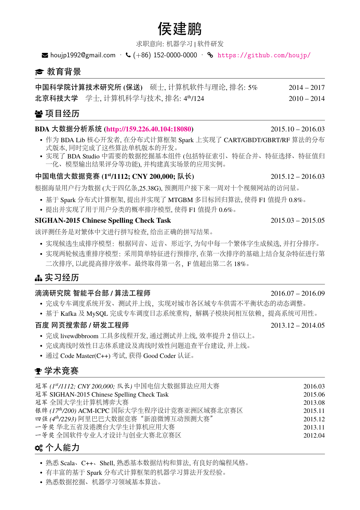
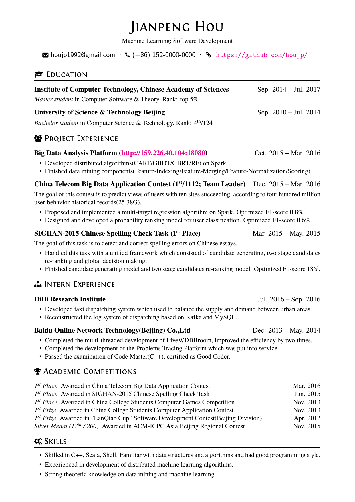
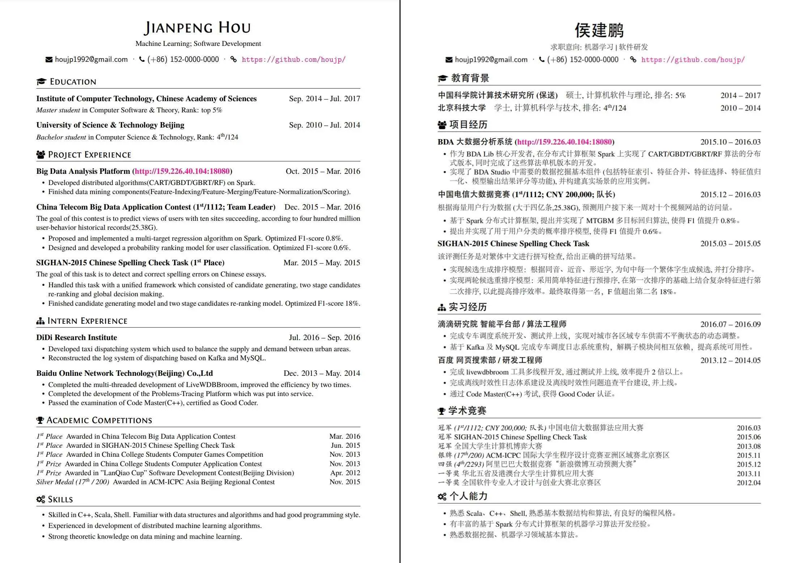

# XeLaTeX resume (self-contained)

Bilingual academic résumé for **Junming Huang / 黄俊铭**, based on the
[billryan](https://github.com/billryan/resume) / [houjp](https://github.com/houjp/resume)
elegant template. This folder is meant to clone and compile on another machine
**without hunting for missing files**.

Preview of the template layout (houjp demo assets, not this CV's content):







Source lives in this GitHub Pages repo:
[dreaming-huang/dreaming-huang.github.io](https://github.com/dreaming-huang/dreaming-huang.github.io)
→ site: <https://cv.jream.top/>

## Compile

From this `resume/` directory, with **XeLaTeX**:

```bash
xelatex resume.tex      # Chinese
xelatex resume_en.tex   # English
```

Or:

```bash
make          # both
make cn       # Chinese only
make en       # English only
make clean    # aux files + PDFs
```

Run `xelatex` twice only if you add citations/outlines; these files have no bibliography.

## Required TeX Live packages

A full TeX Live (or MacTeX / TeX Live for Windows) with XeLaTeX is enough. On
Debian/Ubuntu:

```bash
sudo apt install texlive-xetex texlive-lang-chinese texlive-fonts-recommended texlive-latex-extra texlive-fonts-extra
```

| Need | Typical TeX Live collection |
| --- | --- |
| XeLaTeX, `fontspec`, `xltxtra` | `texlive-xetex` |
| `xeCJK` (and **Fandol** if you use the fallback) | `texlive-lang-chinese` |
| `fontawesome` (FA4; `\faEnvelope`, `\faGraduationCap`, …) | `texlive-fonts-extra` (package `fontawesome`) |
| `titlesec`, `enumitem`, `setspace`, `xifthen`, `nth` | `texlive-latex-extra` |

This repo does **not** vendor a local `fontawesome.sty` or `fontawesome-webfont.ttf`.
Use the TeX Live `fontawesome` package.

Latin text uses **TeX Gyre Termes** OTFs plus **Fontin SmallCaps**, already under
`fonts/Main/` so an offline clone still matches the template (`Path = fonts/Main/`
in `resume.cls`).

## Chinese fonts: Adobe (default) vs Fandol (fallback)

**Default** — both `resume.tex` and `resume_en.tex` load Adobe CJK fonts from
`fonts/zh_CN-Adobe/`:

```tex
\usepackage{zh_CN-Adobefonts_external}
```

Expected files (already in this folder):

- `AdobeSongStd-Light.otf`
- `AdobeHeitiStd-Regular.otf`
- `AdobeKaitiStd-Regular.otf`
- `AdobeFangsongStd-Regular.otf`

**Fandol fallback** — on a machine where those OTFs are missing, or if you prefer
TeX Live–only fonts, switch to:

```tex
% \usepackage{zh_CN-Adobefonts_external}
\usepackage{zh_CN-fandol}
```

`zh_CN-fandol.sty` uses xeCJK + Fandol Song/Hei/Kai/Fang from TeX Live (no `Path`
to local files).

## Layout

```
resume/
  resume.tex / resume_en.tex   % CV body
  resume.cls                   % class (geometry, Font Awesome, Termes)
  zh_CN-Adobefonts_external.sty  % default CJK
  zh_CN-fandol.sty               % TeX Live Fandol fallback
  linespacing_fix.sty
  fonts/Main/*.otf             % TeX Gyre Termes + Fontin SmallCaps
  fonts/zh_CN-Adobe/*.otf      % Adobe Song/Hei/Kai/Fang
  imgs/                        % README preview (template demo)
  Makefile
```

Compiled PDFs are gitignored (source-first). Generate them locally after clone.
